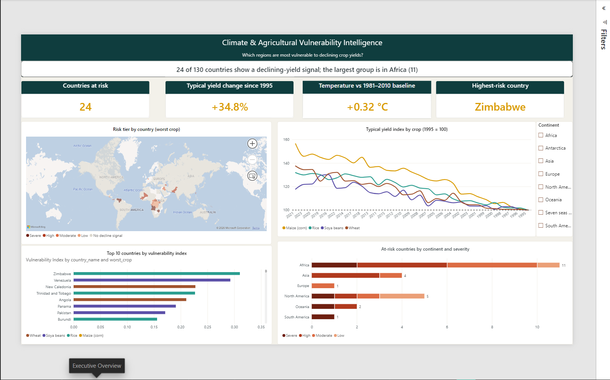
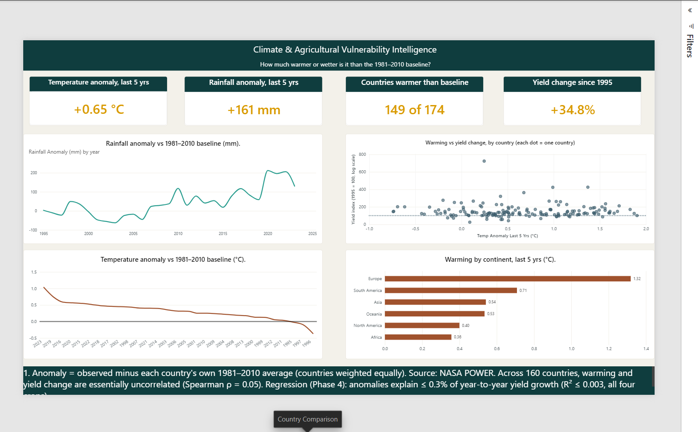
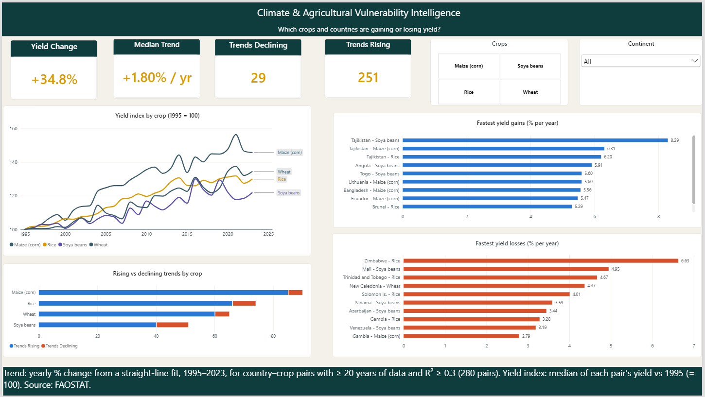
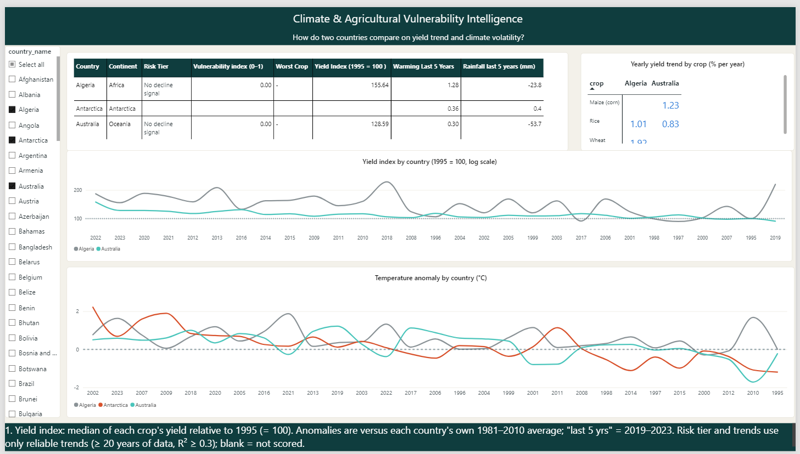
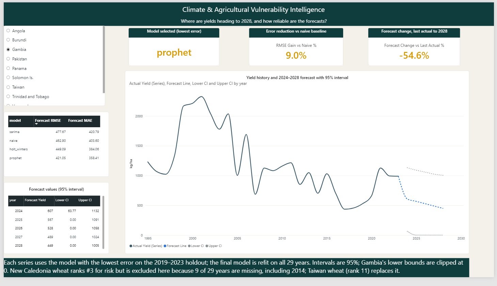
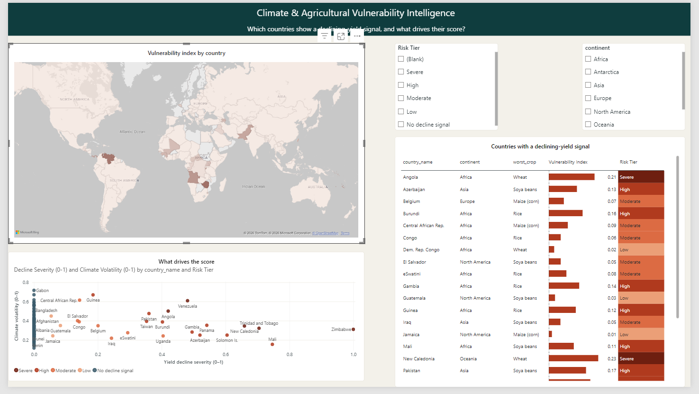
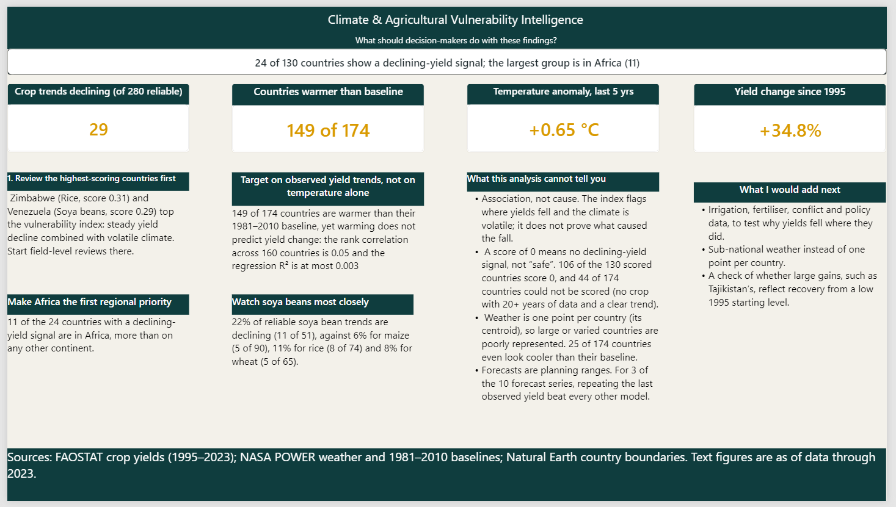
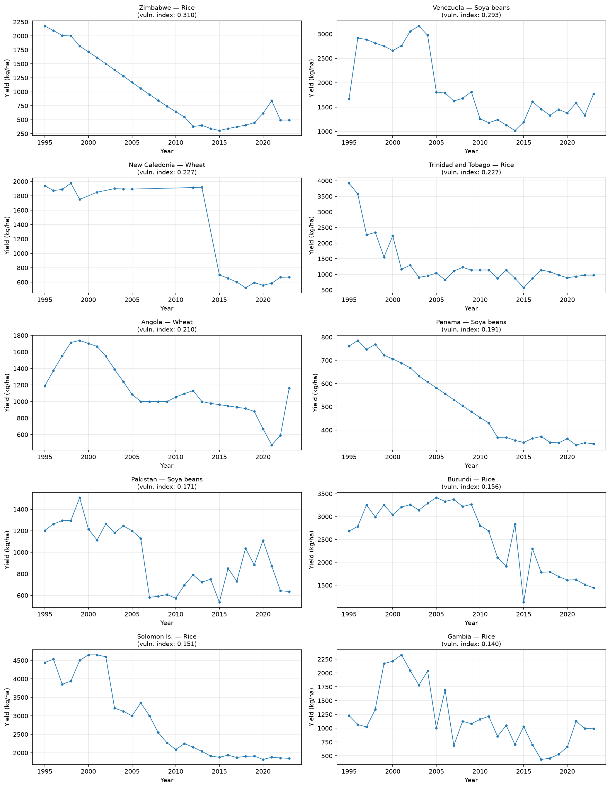

# Climate & Agricultural Vulnerability Intelligence

**Which regions are most vulnerable to declining crop yields?**


An end-to-end analytics project: a Python data pipeline, a PostgreSQL star schema with SQL views, statistical testing, a four-model forecasting comparison and an interactive seven-page Power BI dashboard. It combines 29 years (1995–2023) of FAOSTAT yields for four staple crops (maize, rice, soya beans, wheat) with NASA POWER weather for 174 countries.

---

## Headline finding

Of 174 countries, **130** had a crop trend reliable enough to score, and **24 of them show a declining-yield signal; 11 of those 24 are in Africa.** Zimbabwe (rice) and Venezuela (soya beans) score highest.

The surprise: **149 of 174 countries are warmer than their 1981–2010 baseline, yet climate anomalies explain almost none of the year-to-year change in yields** (regression R² ≤ 0.003), and the typical country-crop yield is up about 35% since 1995.

**Recommendation:** target support using observed yield trends, not temperature alone.

## Key numbers

| Measure | Result |
|:---|:---|
| Countries with weather data | 174 |
| Countries scored (at least one reliable crop trend) | 130 |
| Countries with a declining-yield signal | 24 (11 in Africa) |
| Highest vulnerability scores | Zimbabwe (rice) 0.31 · Venezuela (soya beans) 0.29 · New Caledonia (wheat) 0.23 |
| Typical yield change since 1995 (median country-crop) | +34.8% |
| Reliable crop trends rising / declining | 251 / 29 (of 280) |
| Soya beans: share of reliable trends that are declining | 22% (11 of 51) |
| Countries warmer than their baseline, 2019–2023 average | 149 of 174 |
| Warming vs. yield change, rank correlation (160 countries) | 0.05 |
| Climate anomalies vs. yield growth, regression R² | ≤ 0.003 (all four crops) |
| Forecast series where a naive baseline beat every other model | 3 of 10 |

---

## The dashboard

Seven pages, each built to answer one question. The `.pbix` file is not in this repository because it embeds a full copy of the data; it is available on request. Every page is shown below.

### 1. Executive Overview
The headline finding, key figures, the risk-tier world map and the most vulnerable countries.



### 2. Climate Trends
Temperature and rainfall anomalies against each country's 1981–2010 baseline, warming by continent, and the scatter showing that warming and yield change are essentially unrelated.



### 3. Crop Yield
Yield index by crop (1995 = 100), rising versus declining trends by crop, and the fastest gains and losses.



### 4. Country Comparison
Pick two to four countries and read them side by side: risk tier, yield index, warming, rainfall and the trend of every crop.



### 5. Forecast
Yield history with 2024–2028 forecasts and 95% intervals, plus the model-error table that shows which model won for each series.



### 6. Risk Map
The vulnerability index by country, with a ranked table.



### 7. Recommendations
What to do first, and an explicit list of what the analysis cannot tell you.



---

## How it was built

```
FAOSTAT · NASA POWER · World Bank · Natural Earth
        │  Python (requests, pandas, geopandas)
        ▼
   cleaned CSVs ──► PostgreSQL (8 tables, 3 views)
                        │            │
                        │            └─► Python: statistics + forecasting (statsmodels, scipy, Prophet)
                        ▼
                  Power BI (star schema, DAX measures)
```

### Data

| Dataset | Source | Notes |
|:---|:---|:---|
| Crop yields | FAOSTAT, Crops and Livestock Products | 4,209,110-row bulk file reduced to 13,745 yield records for four crops |
| Weather, 1995–2023 | NASA POWER | Annual temperature and precipitation at each country's centroid |
| Climate baseline, 1981–2010 | NASA POWER | Same source and method as the weather data |
| Population | World Bank (SP.POP.TOTL) | Loaded into the database |
| Country boundaries and centroids | Natural Earth | 177 countries reduced to 174 after removing three disputed territories with an invalid placeholder ISO code |

### Database

PostgreSQL 18 with eight tables (`countries`, `calendar`, `climate`, `weather`, `population`, `crop_yields`, `forecasts`, `model_validation`) and three views (`vw_country_yearly_summary`, `vw_regional_risk`, `vw_vulnerability_by_crop`). In Power BI the tables form a star schema around `countries`.

### Vulnerability index

```
decline_severity    = max(-trend % per year, 0)          only crops with 20+ years of data and R² ≥ 0.3
climate_volatility  = mean(norm(σ temperature anomaly), norm(σ rainfall anomaly))
vulnerability_index = norm(decline_severity) × climate_volatility
```

The score is multiplicative on purpose: a country must show both a falling yield and a volatile climate to rank high. It is a relative ranking inside this dataset, not a calibrated real-world scale. Dashboard tiers use fixed cut-offs: Severe ≥ 0.20, High ≥ 0.10, Moderate ≥ 0.05, Low > 0, and No decline signal at 0.

106 of the 130 scored countries score exactly 0. A zero means no declining-yield signal, not "safe", which is why the headline reports 24 countries at risk rather than "130 scored".

### Statistics

- **Correlation, two passes.** On raw levels, temperature correlates negatively with yield for all four crops (r = −0.27 to −0.38). I read this as cross-country confounding (hot-climate producers tend to run lower-input farming systems), not a climate effect. On the within-country test (anomalies against yield growth) every correlation is negligible (|r| < 0.04).
- **Regression.** Yield growth against temperature anomaly, rainfall anomaly and a centred year, one OLS model per crop. R² is at most 0.003 and the maximum VIF is about 1.4.
- **Across countries.** The rank correlation between recent warming and yield change is 0.05 (160 countries).

### Forecasting

- **Scope.** The ten highest-scoring country-crop pairs (one substituted because of a data gap: Taiwan wheat replaced New Caledonia wheat).
- **Models.** Naive baseline, Holt-Winters (damped trend), SARIMA (1,1,1) and Prophet.
- **Evaluation.** Trained on 1995–2018 and tested on 2019–2023, scored by RMSE and MAE. The model with the lowest RMSE is chosen per series, then refit on the full history to forecast 2024–2028 with 95% intervals.
- **Result.** Holt-Winters won 4 series, the naive baseline 3 (Venezuela, Panama, Solomon Islands), Prophet 2 and SARIMA 1. Prophet was the worst model on 7 of 10 series.



---

## Data quality and validation

- **Two independent implementations.** The vulnerability index was built in Python and again as a PostgreSQL view. Comparing them caught a real bug: the Python volatility calculation silently reweighted years by how many crops a country reported. The SQL version was adopted.
- **Dashboard figures cross-checked against SQL.** The measures and the figures typed into the Recommendations page were compared with independent queries. The scripts are in [`sql/powerbi_checks/`](sql/powerbi_checks/).
- **Issues found and fixed along the way**
  - Palestine's crop data ends in 2022, which would have skewed a per-country yield index. A fixed end-year measure now handles it.
  - The "worst crop" field named soya beans for a country where it is the fastest-growing crop, because all its crops tied at zero. It is now hidden when the score is 0.
  - A temperature-anomaly measure returned a large negative number for years with no weather data. It now returns blank.
  - The yield index uses the median rather than the mean: a few near-zero starting yields push the mean to 167 while the typical value is 135.

## Limitations

- **Association, not cause.** The project does not claim climate change caused any decline. Zimbabwe and Venezuela, the two top scores, have well-documented non-climate drivers (land reform and economic crisis) that plausibly explain much of their decline.
- **One weather point per country.** Weather is sampled at the country centroid, which represents large or varied countries poorly. 25 of 174 countries even look cooler than their baseline.
- **Relative score.** The index ranks countries against each other; a score of 0.31 has no meaning outside this comparison.
- **44 countries are not scored** because no crop has 20+ years of data and a clear trend.
- **Forecasts are planning ranges.** Training windows are only 24 years, and the SARIMA order was fixed rather than tuned per series.
- **Rainfall.** Rainfall anomalies are noticeably larger in 2020–2023 than in earlier years. I did not investigate whether that reflects climate or the behaviour of the data source, so the dashboard shows the anomaly without interpreting it as a trend.

---

## Repository structure

```
├── README.md
├── requirements.txt
├── .env.example            # template for the database password (the real .env is never committed)
├── notebooks/
│   ├── 01_data_collection.ipynb   # acquisition and cleaning
│   ├── 02_sql_database.ipynb      # schema, load, SQL analysis
│   ├── 03_eda_statistics.ipynb    # correlation, regression, vulnerability index
│   └── 04_forecasting.ipynb       # four-model comparison and final forecasts
├── sql/                    # schema, views, analysis queries
│   └── powerbi_checks/     # queries used to reconcile dashboard numbers
├── powerbi/                # dashboard theme
├── images/                 # dashboard screenshots
└── data/processed/         # cleaned data (raw data is re-created by notebook 01)
```

## Reproduce it

1. Install Python 3.12 and run `pip install -r requirements.txt`.
2. Install PostgreSQL and create an empty database named `climate_agri_intelligence`.
3. Copy `.env.example` to `.env` and set `DB_PASSWORD`.
4. Run the notebooks in order, 01 to 04. Notebook 01 downloads the FAOSTAT file and calls the NASA POWER API (about 15 to 20 minutes).
5. The Power BI file is available on request. The screenshots above show every page.

## Data licences

FAOSTAT data are used under FAO's open-data terms (CC BY-NC-SA 3.0 IGO). NASA POWER and Natural Earth are public domain. World Bank data are CC BY 4.0.

---

**Ivy Wangari Kimenju** · Data Analyst · Nairobi, Kenya
[LinkedIn](https://www.linkedin.com/in/ivy-kimenju) · [GitHub](https://github.com/kimenjuivy)
